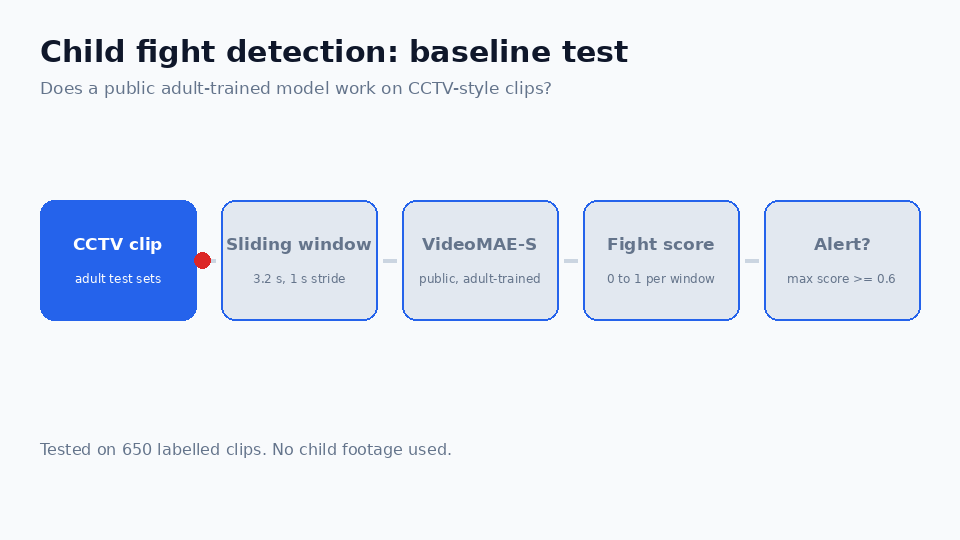
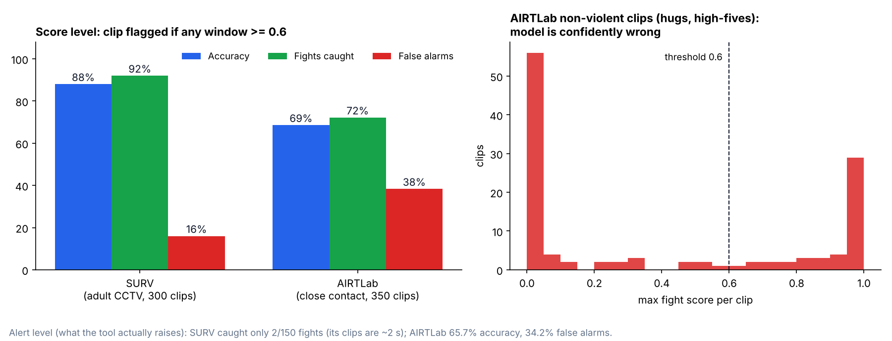

# Child Fight Detection: Baseline Test of a Public Adult-Trained Model



Independent R&D project. Goal: detect fights involving children on CCTV-style video without hurting accuracy.
Before building anything, we checked the obvious shortcut: **does an existing public model already do the job?**

**Short answer: no.** No public model is trained on child fighting. The best public adult model we found (VideoMAE) does not hold up on
close-contact scenes such as hugs and high-fives, which is exactly what children do all day. Our first accuracy numbers also turned out to be
more flattering than what the tool really alerts on; both views are reported below.

## Results

Model: [harshakalluri1403/Violence-Detection](https://github.com/harshakalluri1403/Violence-Detection) (MIT), fine-tuned **VideoMAE-S** checkpoint,
window 3.2 s, stride 1.0 s, CPU, no int8 (it fails on Apple silicon). Datasets: SURV (300 clips, 150 fight / 150 no-fight, median 2.0 s) and
AIRTLab (350 clips, 230 violent / 120 non-violent, median 5.3 s). No child footage.

**1. Score level**: a clip is flagged if any window scores above the threshold.

| Dataset | Threshold | Accuracy | Fights caught | False alarms | Precision |
|---|---|---|---|---|---|
| SURV | 0.6 | **88.0%** | 138/150 (92%) | 24/150 (16.0%) | 85.2% |
| SURV | 0.9 | 87.3% | 132/150 (88%) | 20/150 (13.3%) | 86.8% |
| AIRTLab | 0.6 | **68.6%** | 166/230 (72.2%) | 46/120 (38.3%) | 78.3% |
| AIRTLab | 0.9 | 64.3% | 138/230 (60%) | 33/120 (27.5%) | 80.7% |

**2. Alert level**: what the tool actually raises (it must form an incident from the smoothed scores; defaults: open at 0.6, close below 0.4, minimum 0.8 s).

| Dataset | Accuracy | Fights alerted | False alarms | Precision |
|---|---|---|---|---|
| SURV | 50.7% | 2/150 (1.3%) | 0/150 | 100% (2 of 2) |
| AIRTLab | 65.7% | 151/230 (65.7%) | 41/120 (34.2%) | 78.6% |



Per-clip scores are in [`results/`](results/); both tables can be recomputed from them and from [`results/alert_level_summary.md`](results/alert_level_summary.md).

## What we learned

1. **A score is not an alert.** On SURV, 138 of 150 fights scored above 0.6 but the tool alerted on only 2. SURV clips are about 2 s, shorter than the 3.2 s window.
   We read the event rules in the upstream code (smoothing, hysteresis, minimum 0.8 s) but have not confirmed exactly why 2 s clips produce no event.
   Treat SURV as a test of the scorer only, and AIRTLab (median 5.3 s) as the first fair alert-level test.
2. **Close contact is the problem.** On AIRTLab the tool alerts on 34% of non-violent clips (hugs, high-fives) and misses 34% of fights.
3. **Raising the threshold does not fix it.** At 0.9 AIRTLab false alarms only drop from 38% to 27.5% (score level), and caught fights drop from 72% to 60%.
4. **The model is overconfident when wrong.** 33 of 120 non-violent AIRTLab clips score 0.9 or higher; 52 of 230 real fights score below 0.1.
5. **It is not a camera-angle issue.** Both AIRTLab cameras show the same 38.3% score-level false alarm rate.
6. **Always inspect raw outputs.** Ten hand-picked clips showed the score/alert gap that the headline numbers hid.
7. **Sample size matters.** With 650 clips the score-level figures carry roughly ±4 to ±5 points of margin. A handful of clips tells you almost nothing.

## Caveats (verified, so please read)

- The upstream repo's headline 90.8% "CCTV held out" figure is a leave-one-dataset-out number, and its 30.7 false alarms/hour figure was measured on stitched test clips. Neither is a field measurement.
- The upstream model trained on Hockey, Movies, RWF-2000 and Real-Life Violence (RLVS). **RLVS is in its training data**, so we did not use it for evaluation. SURV and AIRTLab are not in its training list.
- Both test sets are **adult** datasets. They show how the model behaves on close contact, not how it behaves on children.
- AIRTLab camera pairs show the same scene; if you split it for training, keep both cameras of a clip in the same split.
- Datasets are **not** included here; check each dataset's licence before use.

## Where this leaves the project

Planned pipeline (baseline result PDF in [`docs/`](docs/)):

`detect + track people` → `interaction gate` → `soft child tag` → `fight classifier (clip model + pose, separate "rough play" class)` → `temporal smoothing` → `optional LLM/VLM check` → `human review`

- **Next:** run the raw-output inspection on more varied clips, test longer or looped clips to confirm the short-clip effect, then try an LLM/VLM second stage on clips the model flags.
- **LLM budget idea:** only call the LLM on clips VideoMAE already flags, send 6 to 8 frames at about 448 px with a short structured prompt, use a small model first and a larger one only for uncertain cases, cache repeats and cap calls per camera.
  A rough estimate for the 212 AIRTLab clips flagged at score level is about 0.5M input tokens, roughly $0.06 with a small model and $1.17 with a mid-size one (arithmetic from published prices; not measured).
- **Open:** real child-scene data, a play-fight class, and the privacy/legal review for processing children's footage (UAE).
  Do not send child footage to a hosted API without that review.

## Reproduce

Needs Python 3.10+ and git. Datasets go in `~/fight-datasets/` with folder names containing `fight`/`nofight` or `violent`/`non-violent`.

```bash
bash scripts/eval_videomae.sh SURV AIRTLab --model small   # scores.csv + score-level metrics at 0.6 and 0.9
bash scripts/inspect_clips.sh ~/some/clips                  # JSON, timeline, Grad-CAM for a few clips
python3 scripts/make_assets.py                              # rebuilds the chart and GIF from results/*.csv
```

## Layout

```
assets/    overview.gif, results.png
results/   per-clip max scores, alert-level summary
scripts/   evaluation, inspection, asset and PDF scripts
docs/      one-page baseline result PDF
```

## Credits

Model: [harshakalluri1403/Violence-Detection](https://github.com/harshakalluri1403/Violence-Detection) (MIT), built on VideoMAE.
Datasets: SURV, AIRTLab Violence Detection Dataset.
